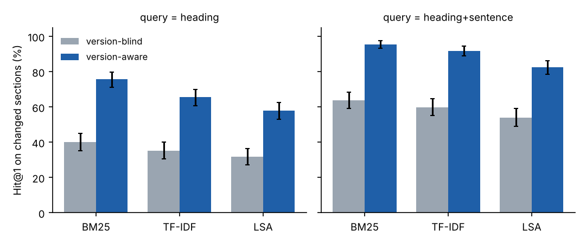
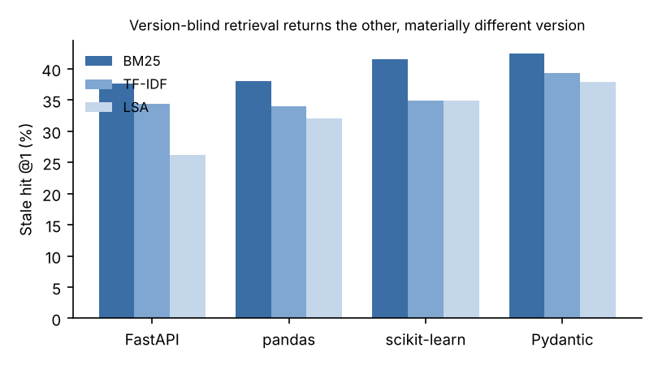
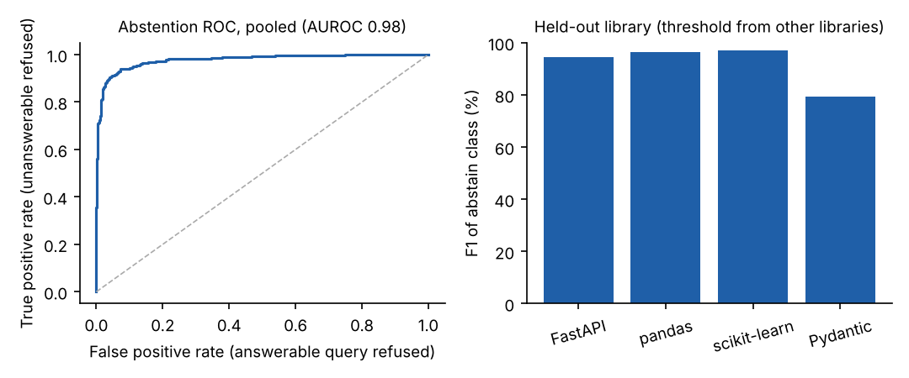
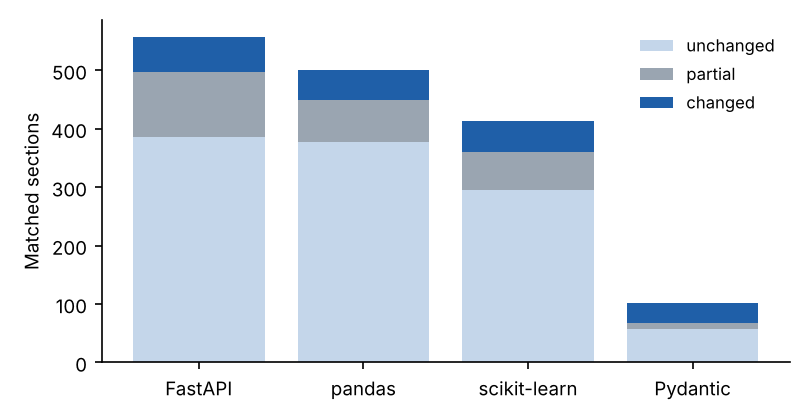

# Does the Version Matter?
### A measurement study of version-aware retrieval over real software documentation

**Authors:** Gyanankur Pratim Baruah and Anjali Tiwari, Thakur Shyamnarayan Degree College, Mumbai
**Paper:** [`paper/manuscript.pdf`](paper/manuscript.pdf)  |  **Status:** complete, fully reproducible, no external APIs

Documentation exists in many versions, and a retriever that ignores versions can hand a question-answering
assistant a page that was only correct for an older release. We measure how often that happens on **real
documentation snapshots** of FastAPI, pandas, scikit-learn and Pydantic (two release tags each), using three classical
retrievers (BM25, TF-IDF, LSA) and **no language model**. Everything below is computed by the code in this repo.

## Headline results

* **Version-blind retrieval often returns the wrong, materially different version.** On sections whose text changed
  between releases, the top result was the *other* version for 32-40% of topic-style (heading) queries.
* **Filtering by the requested version removes that error completely** and raises top-1 accuracy from
  32-40% to 58-76%.
* **A single retrieval-score threshold can refuse most out-of-corpus questions**: pooled leave-one-library-out F1 of
  92.3% (AUROC 0.978) while still answering 96.0% of answerable queries.

### Experiment A/B: version confusion on changed sections (95% CIs are in the paper)
| Retriever | Query | Hit@1 blind | Hit@1 version-aware | Stale@1 blind | Stale@1 aware |
|---|---|---|---|---|---|
| BM25 | heading | 40.1% | **75.6%** | 39.6% | 0.0% |
| TF-IDF | heading | 35.3% | **65.5%** | 35.3% | 0.0% |
| LSA | heading | 31.7% | **57.9%** | 32.0% | 0.0% |
| BM25 | heading+sentence | 63.7% | **95.4%** | 31.2% | 0.0% |
| TF-IDF | heading+sentence | 59.9% | **91.9%** | 33.0% | 0.0% |
| LSA | heading+sentence | 54.1% | **82.5%** | 32.5% | 0.0% |

*Stale@1 = the top result is the other version's section and its content differs materially. Aware mode searches only the requested version, so it cannot return a stale hit by construction.*





### Experiment C: abstaining on out-of-corpus queries (leave-one-library-out)
| Held-out library | F1 | Precision | Recall | AUROC |
|---|---|---|---|---|
| FastAPI | 94.6% | 95.3% | 94.0% | 0.973 |
| pandas | 96.3% | 97.3% | 95.3% | 0.992 |
| scikit-learn | 97.1% | 94.9% | 99.3% | 0.997 |
| Pydantic | 79.4% | 95.3% | 68.0% | 0.945 |
| **Pooled** | **92.3%** | 95.7% | 89.2% | 0.978 |



### Data composition


## Reproduce (about a minute, CPU only, no network)
```bash
pip install -r requirements.txt
./reproduce.sh        # parse docs -> run study -> regenerate README -> rebuild paper PDF (needs pdflatex)
```
Everything is deterministic (seed 0). `scripts/fetch_docs.sh` re-downloads the snapshots at the pinned tags if you want to verify them.

## Layout
```
data/raw_docs/          documentation snapshots (md/rst only; upstream licences, see data/NOTICE.md)
data/sections.jsonl     parsed sections;   data/pairs.json  version-paired sections with change class
scripts/                fetch_docs.sh, build_sections.py, make_readme.py
experiments/run_study.py   all experiments, figures, tables and paper macros
results/                CSVs, per-query results, figures/, LaTeX tables and macros.tex
paper/                  manuscript.tex / .pdf, references.bib, build.sh
```

## Limitations (details in the paper)
Synthetic queries built from headings; section-level relevance; "changed" is a lexical definition; classical retrievers
only (no trained dense models); the abstention task uses easy out-of-library queries; four libraries, two releases each;
no language model is evaluated. This is a small measurement study, not a benchmark of question-answering systems.

## Cite
See `CITATION.cff`.
